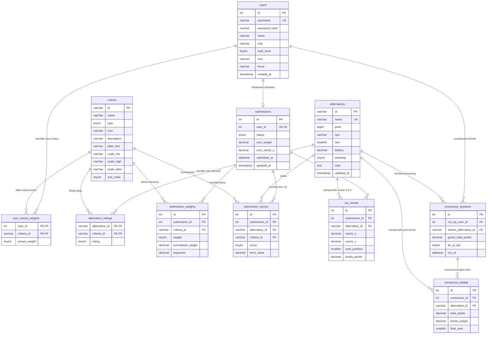

# LAPORAN PROGRES PROJECT AKHIR SEMESTER
## Group Decision Support System (GDSS) Pemilihan Laptop Laboratorium Komputer Menggunakan Metode Weighted Product dan Borda

**Teknologi yang Digunakan:** HTML5, CSS3, Vanilla JavaScript, PHP Native (PDO & Session), dan MySQL (XAMPP / phpMyAdmin)

---

## 1. Latar Belakang

Pengadaan perangkat komputer, khususnya laptop untuk kebutuhan Laboratorium Komputer, merupakan keputusan strategis yang melibatkan lebih dari satu pihak dengan sudut pandang dan prioritas yang berbeda-beda. Dalam praktiknya, terdapat tiga pihak utama (*Decision Maker*) yang berkepentingan:

1. **Kepala Lab** — berfokus pada efisiensi anggaran dan kesesuaian harga per unit.
2. **Dosen Pengampu** — berfokus pada performa komputasi (prosesor dan kapasitas RAM) agar perangkat mampu menjalankan perangkat lunak praktikum dengan lancar.
3. **Asisten Lab** — berfokus pada kemudahan perawatan harian, daya tahan baterai, serta lama dan cakupan garansi.

Apabila proses pemilihan dilakukan secara manual atau melalui diskusi tanpa metode terstruktur, keputusan berisiko menjadi subjektif, memakan waktu lama, sulit dipertanggungjawabkan secara transparan, serta berpotensi menimbulkan bias pada salah satu kepentingan saja.

Oleh karena itu, dibangun sebuah aplikasi berbasis web **Group Decision Support System (GDSS)** menggunakan **HTML, CSS, JavaScript, PHP Native, dan database relasional MySQL (phpMyAdmin/XAMPP)**. Sistem ini mengombinasikan metode **Weighted Product (WP)** untuk menghasilkan peringkat individu tiap *Decision Maker* berdasarkan bobot preferensinya masing-masing, serta metode **Borda** untuk menggabungkan seluruh peringkat individu tersebut menjadi satu keputusan konsensus kelompok yang adil, terukur, dan terdokumentasi di dalam database.

---

## 2. Kriteria Pengambilan Keputusan dan Bobot

### 2.1 Daftar Kriteria
Sistem menggunakan **5 kriteria utama** dengan pembagian jenis **Cost** (semakin kecil semakin baik) dan **Benefit** (semakin besar semakin baik), menggunakan skala penilaian **1 sampai 5**:

| Kode | Nama Kriteria | Jenis | Keterangan | Skala Penilaian (1–5) |
|---|---|---|---|---|
| **C1** | Harga | **Cost** | Harga per unit laptop | 1 = sangat murah … 5 = sangat mahal |
| **C2** | Prosesor | **Benefit** | Performa prosesor | 1 = sangat lemah … 5 = sangat kencang |
| **C3** | RAM | **Benefit** | Kapasitas memori utama | 1 = sangat kecil … 5 = sangat besar |
| **C4** | Baterai | **Benefit** | Daya tahan baterai | 1 = sangat boros … 5 = sangat awet |
| **C5** | Garansi | **Benefit** | Lama & cakupan garansi | 1 = sangat singkat … 5 = sangat panjang |

### 2.2 Bobot Preferensi Tiap Decision Maker
Karena sistem ini merupakan **GDSS**, setiap *Decision Maker* dapat menentukan bobot kepentingannya sendiri (skala 1–5) untuk setiap kriteria. Sistem menyediakan saran bobot awal (*preset*) di tabel `user_preset_weights` yang dapat diubah sesuai penilaian masing-masing:

| Kriteria | Kepala Lab ($w$) | Normalisasi $W_j$ (Kepala) | Dosen Pengampu ($w$) | Normalisasi $W_j$ (Dosen) | Asisten Lab ($w$) | Normalisasi $W_j$ (Asisten) |
|---|---:|---:|---:|---:|---:|---:|
| **C1 – Harga (Cost)** | 5 | 0,3125 (−) | 2 | 0,1111 (−) | 3 | 0,1765 (−) |
| **C2 – Prosesor (Benefit)** | 3 | 0,1875 (+) | 5 | 0,2778 (+) | 2 | 0,1176 (+) |
| **C3 – RAM (Benefit)** | 3 | 0,1875 (+) | 5 | 0,2778 (+) | 3 | 0,1765 (+) |
| **C4 – Baterai (Benefit)** | 2 | 0,1250 (+) | 3 | 0,1667 (+) | 4 | 0,2353 (+) |
| **C5 – Garansi (Benefit)** | 3 | 0,1875 (+) | 3 | 0,1667 (+) | 5 | 0,2941 (+) |
| **Total ($\Sigma w$ / $\Sigma W_j$)** | **16** | **1,0000** | **18** | **1,0000** | **17** | **1,0000** |

---

## 3. Alternatif

Sistem menyediakan **5 alternatif laptop** awal yang tersimpan pada tabel `alternatives` (dan dapat ditambah, diedit, atau dihapus oleh Kepala Lab sebelum konsensus dijalankan):

| Kode | Nama Alternatif | Harga (C1) | Prosesor (C2) | RAM (C3) | Baterai (C4) | Garansi (C5) | Catatan |
|---|---|---:|---|---:|---:|---:|---|
| **A1** | Asus ExpertBook B1 | Rp 10.500.000 | Intel Core i5-1235U | 8 GB | 10 jam | 2 tahun | Seimbang untuk kebutuhan lab umum, bodi ringan dan kokoh |
| **A2** | Lenovo ThinkPad E14 | Rp 14.500.000 | AMD Ryzen 5 7530U | 16 GB | 11 jam | 3 tahun | Keyboard nyaman, suku cadang mudah didapat, garansi panjang |
| **A3** | HP ProBook 440 | Rp 12.000.000 | Intel Core i5-1335U | 8 GB | 9 jam | 1 tahun | Harga menengah, performa cukup untuk praktikum standar |
| **A4** | Acer TravelMate P2 | Rp 8.900.000 | Intel Core i3-1215U | 8 GB | 8 jam | 1 tahun | Paling terjangkau, cocok untuk anggaran terbatas |
| **A5** | Dell Latitude 3440 | Rp 15.500.000 | Intel Core i7-1355U | 16 GB | 10 jam | 3 tahun | Performa tertinggi, layanan purna jual korporat |

### Nilai Referensi Skala 1–5 (`alternative_ratings`)
| Alternatif | C1 (Harga) | C2 (Prosesor) | C3 (RAM) | C4 (Baterai) | C5 (Garansi) |
|---|---:|---:|---:|---:|---:|
| **A1 – Asus ExpertBook B1** | 2 | 3 | 3 | 4 | 3 |
| **A2 – Lenovo ThinkPad E14** | 4 | 4 | 4 | 4 | 5 |
| **A3 – HP ProBook 440** | 3 | 4 | 3 | 3 | 2 |
| **A4 – Acer TravelMate P2** | 1 | 2 | 3 | 2 | 2 |
| **A5 – Dell Latitude 3440** | 5 | 5 | 4 | 3 | 5 |

---

## 4. Metode yang Digunakan

Aplikasi menerapkan **dua tahap metode** secara berurutan yang seluruh perhitungannya dijalankan di sisi server PHP (`includes/gdss_math.php`):

### 4.1 Tahap 1: Weighted Product (WP) — Penilaian Individu
Digunakan untuk menghasilkan peringkat alternatif versi masing-masing *Decision Maker*:

1. **Normalisasi Bobot ($W_j$):**
   $$W_j = \frac{w_j}{\sum_{k=1}^{m} w_k}$$
   Dengan tanda pangkat $+W_j$ untuk kriteria **Benefit** dan $-W_j$ untuk kriteria **Cost**.

2. **Menghitung Vektor $S$:**
   $$S_i = \prod_{j=1}^{m} X_{ij}^{\pm W_j}$$

3. **Menghitung Vektor $V$ (Preferensi Relatif):**
   $$V_i = \frac{S_i}{\sum_{i=1}^{n} S_i}$$
   Alternatif diurutkan dari nilai $V_i$ terbesar (Peringkat 1) hingga terkecil (Peringkat $n$).

### 4.2 Tahap 2: Metode Borda — Konsensus Kelompok
Digunakan oleh **Kepala Lab** setelah seluruh *Decision Maker* selesai mengirim penilaian WP:

1. **Konversi Peringkat ke Poin Borda:**
   Untuk $n$ alternatif, Peringkat 1 mendapat $n$ poin, Peringkat 2 mendapat $n-1$ poin, …, hingga Peringkat $n$ mendapat $1$ poin. (Jika nilai $V$ seri, poin dirata-rata.)
2. **Penjumlahan Total Poin & Bobot Borda:**
   $$\text{Total Poin}_i = \sum_{d=1}^{D} \text{Poin}_{i,d}, \qquad \text{Bobot Borda}_i = \frac{\text{Total Poin}_i}{\sum_{k=1}^{n} \text{Total Poin}_k}$$
3. **Penentuan Pemenang & Aturan Seri (*Tie-Breaker*):**
   Alternatif dengan total poin terbesar menjadi keputusan kelompok. Jika terjadi poin seri pada peringkat teratas, peringkat dari **Kepala Lab** (`rank_level = 1`) digunakan sebagai penentu.

### 4.3 Contoh Hasil Perhitungan (Data Default)
- **WP Kepala Lab:** #1 A1 Asus ExpertBook B1 ($V = 0{,}21174$), #2 A2 Lenovo ThinkPad E14 ($V = 0{,}20902$), #3 A4 ($V = 0{,}20712$), #4 A5 ($V = 0{,}19609$), #5 A3 ($V = 0{,}17603$).
- **WP Dosen Pengampu:** #1 A2 Lenovo ThinkPad E14 ($V = 0{,}23289$), #2 A5 Dell Latitude 3440 ($V = 0{,}23040$), #3 A1 ($V = 0{,}19688$), #4 A3 ($V = 0{,}18163$), #5 A4 ($V = 0{,}15821$).
- **WP Asisten Lab:** #1 A2 Lenovo ThinkPad E14 ($V = 0{,}23498$), #2 A5 Dell Latitude 3440 ($V = 0{,}21674$), #3 A1 ($V = 0{,}20997$), #4 A4 ($V = 0{,}17059$), #5 A3 ($V = 0{,}16772$).
- **Hasil Konsensus Borda (Grand Total = 45 poin):**
  1. **A2 – Lenovo ThinkPad E14**: $4 + 5 + 5 = \mathbf{14\text{ poin}}$ (**31,11%**) → **Rekomendasi Terpilih**
  2. **A1 – Asus ExpertBook B1**: $5 + 3 + 3 = 11\text{ poin}$ (24,44%)
  3. **A5 – Dell Latitude 3440**: $2 + 4 + 4 = 10\text{ poin}$ (22,22%)
  4. **A4 – Acer TravelMate P2**: $3 + 1 + 2 = 6\text{ poin}$ (13,33%)
  5. **A3 – HP ProBook 440**: $1 + 2 + 1 = 4\text{ poin}$ (8,89%)

---

## 5. Database Aplikasi

Database bernama **`gdss_laptop_lab`** diimplementasikan pada **MySQL (XAMPP / phpMyAdmin)** menggunakan engine **InnoDB** dan **11 tabel ternormalisasi (3NF)** dengan integritas referensial (*Foreign Key*).

### 5.1 Entity Relationship Diagram (ERD)

### 5.2 Ringkasan Struktur Tabel

| No | Nama Tabel | Fungsi Utama | Relasi Kunci (PK / FK) |
|---|---|---|---|
| 1 | `users` | Data akun 3 *Decision Maker* & hash password bcrypt | PK: `id`, UK: `username` |
| 2 | `criteria` | Master 5 kriteria (Cost/Benefit & keterangan skala) | PK: `id` |
| 3 | `alternatives` | Master data spesifikasi laptop yang dibandingkan | PK: `id`, UK: `name` |
| 4 | `alternative_ratings` | Nilai referensi awal (1–5) tiap laptop pada tiap kriteria | PK/FK: `(alternative_id, criteria_id)` |
| 5 | `user_preset_weights` | Saran bobot awal (1–5) tiap peran pada tiap kriteria | PK/FK: `(user_id, criteria_id)` |
| 6 | `submissions` | Header penilaian/draft per *Decision Maker* | PK: `id`, UK/FK: `user_id` |
| 7 | `submission_weights` | Bobot input ($w_j$), normalisasi ($W_j$), dan pangkat ($\pm W_j$) | PK: `id`, FK: `submission_id`, `criteria_id` |
| 8 | `submission_scores` | Matriks keputusan ($X_{ij}$) dan nilai pangkat ($X_{ij}^{\pm W_j}$) | PK: `id`, FK: `submission_id`, `alternative_id`, `criteria_id` |
| 9 | `wp_results` | Hasil WP individu (Vektor $S$, Vektor $V$, peringkat, poin Borda) | PK: `id`, FK: `submission_id`, `alternative_id` |
| 10 | `consensus_sessions` | Header pelaksanaan Konsensus Borda & pemenang | PK: `id`, FK: `run_by_user_id`, `winner_alternative_id` |
| 11 | `consensus_details` | Peringkat akhir, total poin, dan bobot Borda tiap laptop | PK: `id`, FK: `consensus_id`, `alternative_id` |

*(Sertakan juga screenshot tab **Designer** dan daftar tabel dari phpMyAdmin pada laporan cetak/PDF.)*

---

## 6. Halaman Home (Dashboard)

Halaman Home (`index.php` → tampilan **Dashboard** setelah login) dirancang agar pengguna langsung memahami status proses pengambilan keputusan tanpa kebingungan. Komponen utama pada Halaman Home meliputi:

1. **Sidebar & Topbar Navigasi:** Menampilkan identitas akun yang sedang aktif (`Kepala Lab`, `Dosen Pengampu`, atau `Asisten Lab`), badge progres penilaian & konsensus secara *real-time* dari database, tombol navigasi (`Dashboard`, `Penilaian WP`, `Hasil Konsensus`, `Panduan`), tombol `Reset Semua Data` (khusus Kepala Lab), dan `Logout`.
2. **Kartu Aksi Utama (*Next Step Banner*):** Menyesuaikan kondisi database secara otomatis — mengarahkan pengguna untuk mulai mengisi penilaian, menunggu DM lain, menjalankan Konsensus Borda (khusus Kepala Lab), atau melihat hasil pemenang.
3. **Alur Pengambilan Keputusan (3 Tahap):** Visualisasi progres dari tahap penilaian individu, penggabungan Borda oleh Kepala Lab, hingga hasil akhir tersedia.
4. **Status Partisipasi Decision Maker:** Daftar 3 *Decision Maker* lengkap dengan *progress bar* persentase serta stempel waktu (`submitted_at`) dari tabel `submissions`.
5. **Panel Konsensus Borda (Khusus Kepala Lab):** Tombol eksekusi Borda yang otomatis terkunci hingga seluruh DM mengirim penilaian.
6. **Tabel Alternatif Laptop (CRUD MySQL):** Menampilkan spesifikasi lengkap seluruh laptop dari tabel `alternatives` dengan aksi **Detail**, serta tombol **Tambah Laptop**, **Edit**, dan **Hapus** khusus Kepala Lab sebelum konsensus dijalankan.
7. **Tabel Kriteria Pengambilan Keputusan:** Menampilkan 5 kriteria, jenis Cost/Benefit, dan skala penilaian 1–5 dari tabel `criteria`.

*(Sertakan screenshot tampilan Halaman Login dan Halaman Home/Dashboard setelah login sebagai Kepala Lab.)*

---

## 7. Progres Lain

Selain fondasi database dan Halaman Home, progres implementasi yang sudah selesai dibangun antara lain:

1. **Migrasi Penuh ke Arsitektur Client–Server (PHP Native + MySQL):**
   - Koneksi database terpusat menggunakan **PDO** dengan *prepared statements* (aman dari SQL Injection) pada `config/database.php`.
   - 6 endpoint REST JSON API PHP Native di folder `api/` (`auth.php`, `state.php`, `alternatives.php`, `assessment.php`, `consensus.php`, `reset.php`).
2. **Autentikasi PHP Session & Password Hashing (`bcrypt`):**
   - Mendukung login manual dengan verifikasi `password_verify()` ke tabel `users` sekaligus mode demo 1-klik untuk mempermudah pengujian/presentasi.
   - Pembatasan hak akses (*Role-Based Access Control*) di sisi server PHP (`requireLogin()`, `requireHead()`).
3. **Modul Penilaian Weighted Product (Wizard 3 Langkah + Autosave MySQL):**
   - Langkah 1: Pengisian bobot kepentingan (1–5) dengan indikator proporsi otomatis.
   - Langkah 2: Penilaian setiap laptop pada 5 kriteria dengan pengingat skala terbalik pada kriteria Harga (Cost).
   - Langkah 3: Pratinjau peringkat sebelum pengiriman. Draft tersimpan otomatis ke MySQL, dan saat dikirim, perhitungan WP resmi dieksekusi di PHP (`includes/gdss_math.php`) dalam transaksi database.
   - Halaman rincian hasil WP lengkap (Normalisasi Bobot, Matriks Keputusan $X_{ij}$, Vektor $S$, Vektor $V$, Peringkat & Poin Borda).
4. **Modul Hasil Konsensus Borda:**
   - Penggabungan peringkat seluruh DM oleh Kepala Lab di sisi server PHP, lengkap dengan *tie-breaker* jabatan tertinggi, penguncian data pasca-konsensus, penjelasan otomatis mengapa pemenang terpilih, tabel poin & bobot Borda, serta perbandingan peringkat individu tiap DM.
5. **Modul Panduan & Reset Database:**
   - Halaman Panduan interaktif yang menjelaskan alur kerja, arsitektur database MySQL, dan istilah WP/Borda.
   - Fitur **Reset Semua Data** berbasis transaksi SQL untuk mengulang simulasi dari awal.
6. **Rencana Tahap Berikutnya (Menuju Final UAS):**
   - Pengujian end-to-end seluruh skenario di XAMPP lokal (termasuk skenario penambahan laptop baru & kasus seri Borda).
   - Penambahan fitur cetak/ekspor laporan hasil konsensus (Print / PDF) untuk dokumentasi pengadaan lab.
   - Finalisasi dokumentasi pengguna dan penyusunan slide presentasi UAS.
